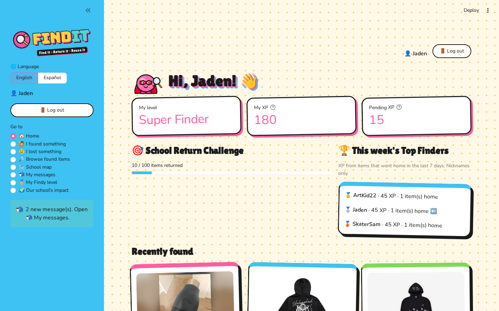
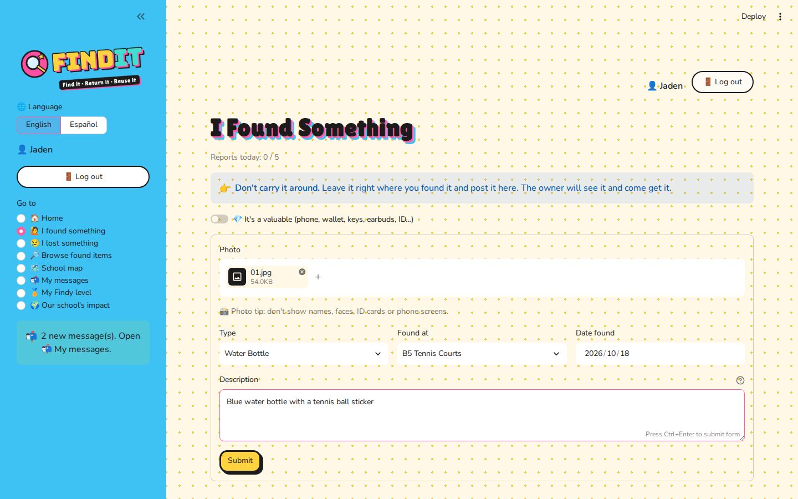
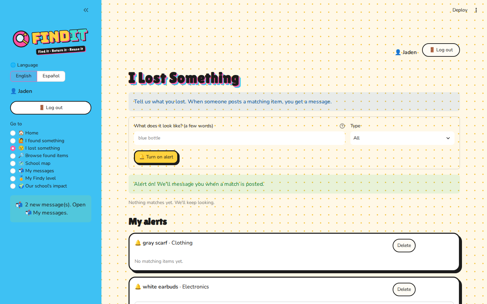
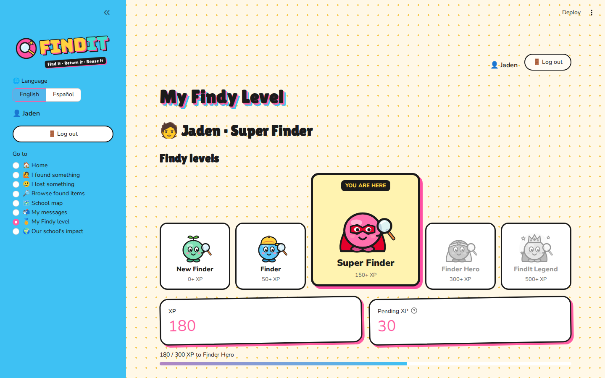

<p align="center">
  
</p>

<h3 align="center">Find it. Return it. Reuse it.</h3>
<p align="center">A lost-and-found web app that helps students get their belongings back.</p>

<p align="center">
  <b>Try it:</b> <a href="https://finditfindit.streamlit.app/">finditfindit.streamlit.app</a> &nbsp;·&nbsp; Demo login: <b>Jaden</b> / <b>1212</b>
</p>

---

## Getting started

1. Open **[finditfindit.streamlit.app](https://finditfindit.streamlit.app/)** in any web browser (laptop, Chromebook, tablet, or phone).
2. Log in with the demo account: **Jaden** / **1212**.
   - To make your own account, open the **✨ Sign up** tab. Use a nickname, not your real name.
3. Use the menu on the left to move between screens. On a phone, tap **>** at the top left to open the menu.



## 🏠 Home

Your starting point.
- See your **level** and **XP**.
- Check the **School Return Challenge** and **this week's Top Finders**.
- Browse **recently found** items, and tap **View details** to open one.
- A notice appears when you have new messages.

## 🙋 I found something

Found something at school? Post it in under a minute.
1. Add a **photo**. Don't show names, faces, ID cards, or phone screens.
2. Pick the **type** and the place where you **found** it.
3. Write a short **description**, for example: *Blue water bottle with a tennis ball sticker*.
4. Tap **Submit**.

**Regular items** (bottles, hoodies, books) stay where you found them.

**Valuable items** (phones, wallets, keys, earbuds, IDs):
1. Turn on **💎 It's a valuable**.
2. Take the item to a Lost & Found desk.
3. Choose that desk under **📍 I turned it in at**.



## 😢 I lost something

Let FindIt keep looking for you.
1. Type a few words about what you lost, like **white earbuds**.
2. Tap **🔔 Turn on alert**.
3. You'll see any items that **already match**.
4. When someone posts a new match, you get a **message**.

Under **My alerts**, you can see how many items match each alert or delete an alert.



## 🔎 Browse found items

Search everything that has been found.
- Type a **keyword** (bottle, jacket, blue…). The best matches show first.
- Narrow the results by **type**, **place**, **status**, or **when** the item was found.
- Each card shows where the item was **found** and where it is **now**.

## Getting your item back

Open the item and tap **View details**.

**Regular item**
1. Go to the spot shown and grab it.
2. Tap **🙋 It's mine! I picked it up**. Done!

**Valuable item**
1. Tap **🙋 It's mine!**
2. Go to the Lost & Found desk shown on the screen. The staff will hand it to you.
3. Tap **🙌 I picked it up**.

**Walking by an item?** Tap **👍 Still there** or **❌ Not there anymore** to help everyone. If an item has waited for days, you can take it to a desk and tap **📦 I took it to the desk**.

## 🗺️ School map

- See where items were found around campus.
- **Green pins** show the Lost & Found desks.

## 📬 My messages

- Alert matches
- Pickup instructions for valuables
- Updates on items you posted, such as when an item goes home

Use the tabs to see **Items I reported** and **My items**.

## 🏅 My Findy level

Earn XP by helping items go home, and level up through five Findy characters:

**New Finder → Finder → Super Finder → Finder Hero → FindIt Legend**

- You get XP for posting an item, and extra XP for a detailed description or for turning in a valuable.
- Your XP becomes **confirmed** only when the item goes back to its owner.
- Unlock special badges such as **Water Bottle Hunter** and **Return Hero**.



## 🌍 Our school's impact

See how the whole school is doing:
- Items reported and returned
- Items returned this week
- Return rate
- Weekly chart

## 🌐 Language and 🚪 Log out

- Switch between **English** and **Español** at the top of the menu.
- **🚪 Log out** is always at the top right of the screen.

## Fair play

- You can't claim an item you posted.
- You can report up to 5 items a day.
- Unclaimed regular items eventually move to the school reuse box. Valuables stay safe at the desk.

---

## Run it on your own computer

```bash
pip install -r requirements.txt
streamlit run app.py
```

Demo data is created automatically on the first run. On Windows, you can double-click `Run_FindIt.bat` instead.

Built with Python, Streamlit, SQLite, and Folium.
