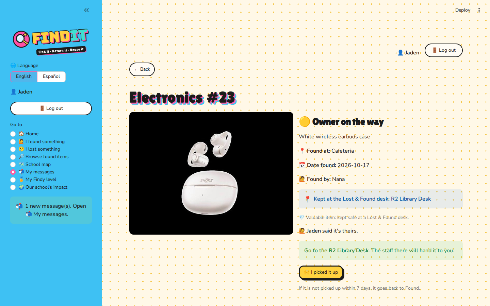
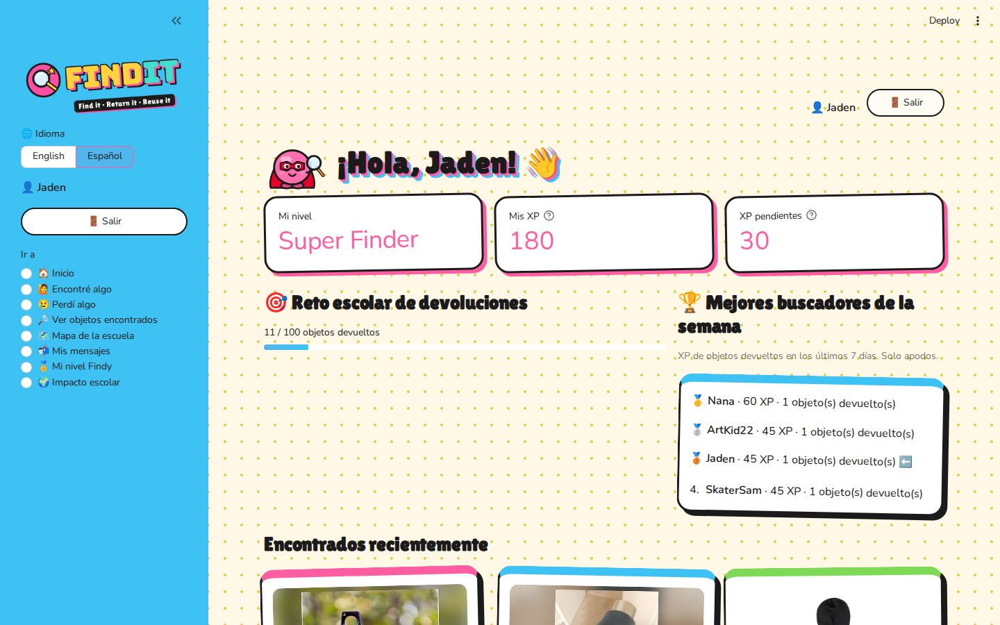

<p align="center">
  
</p>

<h3 align="center">Find it. Return it. Reuse it.</h3>
<p align="center">A game-powered Lost &amp; Found web app for our school.</p>

<p align="center">
  <b>Live demo:</b> <a href="https://finditfindit.streamlit.app/">finditfindit.streamlit.app</a><br>
  Demo login: <b>Jaden</b> / password <b>1212</b>
</p>

---

## Why FindIt?

Students lose water bottles, hoodies, books, and earbuds every day. Most of them are never claimed. By the end of the school year, they pile up, get dirty, and are thrown away.

FindIt makes it easy to **report** a found item, **search** for a lost one, and **get it back** before it ends up in the trash. Points and levels make helping others fun.

## Features

- **🙋 I found something**: Post a photo, the location, and a short description.
  - Regular items stay where they were found.
  - Valuable items (phones, wallets, keys, earbuds) go to a Lost & Found desk.
- **😢 I lost something**: Save a keyword alert, such as "white earbuds." When a matching item is posted, you get a message.
- **🔎 Browse found items**: Search word by word, and the best matches come first. Filter by type, location, status, and date found.
- **🗺️ School map**: A satellite map shows where items were found and where the Lost & Found desks are.
- **📬 My messages**: Get alert matches, pickup instructions, and updates on items you posted.
- **🏅 My Findy level**: Earn XP and level up through 5 Findy characters. Special badges unlock for certain finds.
- **🌍 Our school's impact**: See items returned, items returned this week, and this week's Top Finders.
- **🌐 English / Español**: Switch every screen and message between English and Spanish.
- **Accounts**: Log in, sign up, and log out. Nicknames only, with no real names or phone numbers.

## How returning an item works

**Regular item**
1. The finder posts it and leaves it where it was found.
2. The owner taps **"It's mine! I picked it up."**
3. The item is marked **Returned**.

**Valuable item**
1. The finder turns on **💎 It's a valuable**, takes it to a Lost & Found desk, and posts it.
2. The owner taps **"It's mine!"**
3. The owner gets a message telling them which desk to go to.
4. Staff hand it over in person, and the owner taps **"I picked it up."**

**Keeping items moving**
- Anyone can tap **👍 Still there** or **❌ Not there anymore** on an item.
- If a regular item has waited more than 3 days, the app suggests moving it to a desk.
- If a claimed valuable isn't picked up within 7 days, it goes back to **Found**.
- Regular items unclaimed after 30 days go to the school **Reuse box**. Valuables are never moved there.
  - This rule is tentative and should be set to match the school's own policy.

## Fair play rules

- XP from a found item is confirmed only when the item **actually goes home**.
- You can't claim an item you posted yourself.
- Each person can report up to 5 items a day.
- You can claim only 1 item a day from the same finder. This prevents friends from trading points.
- The app shows a photo safety tip: keep names, faces, and ID cards out of photos.

| Action | XP |
|---|---|
| Report an item | 10 |
| Detailed description | +5 |
| Turn in a valuable at a desk | +15 |
| Item returned to its owner | +30 |

| Level | XP needed |
|---|---|
| 1. New Finder | 0 |
| 2. Finder | 50 |
| 3. Super Finder | 150 |
| 4. Finder Hero | 300 |
| 5. FindIt Legend | 500 |

## Screenshots

| Home | I found something |
|---|---|
|  |  |
| **I lost something** | **Valuable item at a desk** |
|  |  |
| **My Findy level** | **Español** |
|  |  |

## Built with

- **Python**
- **Streamlit**: web interface
- **SQLite**: database
- **Folium**: interactive school map
- **Pillow** and **pandas**: photos and tables

## Project structure

| File | What it does |
|---|---|
| `app.py` | All screens. It only displays data and calls functions in `db.py`. |
| `db.py` | Database tables and every app rule (`save_item`, `claim_item`, `pick_up`, `search_items`, `add_alert`, ...). |
| `lang.py` | Every word on the screen, in English and Spanish. |
| `themes.py` | Colors and styles. |
| `seed.py` | Demo data: sample items from several students and a demo story for Jaden. |
| `test_story.py` | Automated tests that walk through real scenarios (50 checks). |
| `make_art.py` | Draws the 5 Findy level characters as SVG files. |
| `assets/` | Logo, icon, level characters, optional presentation slides. |
| `photos/` | Sample item photos for the demo. |

Screens and rules are kept in separate files, so the rules can be tested without the screens, and the screens can change without breaking the rules.

### Database tables

- `users`: nickname, school email, password
- `items`: photo, category, description, location, status, valuable, desk
- `messages`: alerts and updates for each user
- `lost_alerts`: saved "I lost something" keywords
- `spot_checks`: "Still there / Not there anymore" reports
- `user_badges`: special badges earned

## Run it on your computer

**Windows (easiest)**
1. Install Python 3.12 or 3.13 from [python.org](https://www.python.org/downloads/). Check **"Add python.exe to PATH"** during setup.
2. Double-click **`Run_FindIt.bat`**. The first run takes 1 to 3 minutes.
3. The browser opens. Log in as **Jaden** / **1212**.
4. To start over with fresh demo data, double-click **`Reset_Demo_Data.bat`**.

**Any computer (command line)**
```bash
python -m venv .venv
# Windows: .venv\Scripts\activate    Mac/Linux: source .venv/bin/activate
pip install -r requirements.txt
streamlit run app.py
```
Demo data is created automatically the first time the app starts. To reset it, run `python seed.py`.

**Run the tests**
```bash
python test_story.py
```

**Optional opening slides**

Add `?slides=on` to the address, for example `http://localhost:8501/?slides=on`. Click to move to the next slide.

## Settings

All the numbers are at the top of `db.py`, so they can be changed in one place:
- XP values and level thresholds
- Daily limits
- 3-day, 7-day, and 30-day rules
- Map locations and Lost & Found desks

The map uses Round Rock High School. Building positions are approximate and can be adjusted with the **Map setup** tool on the School map screen.

## What's next (FindIt 2.0)

- Let multiple schools and public places join, each with its own map and settings.
- Smarter matching that understands different descriptions of the same item.
- Friendly return-rate challenges between schools.
- Donate long-unclaimed items, following each school's policy.
- Real email for password reset.
